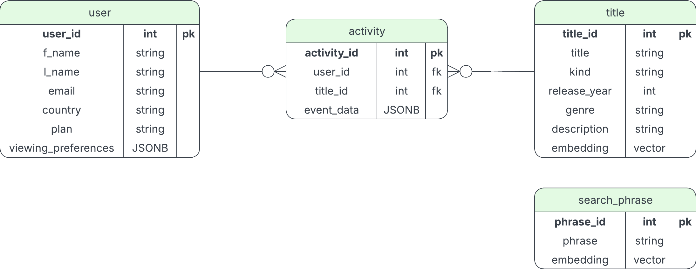
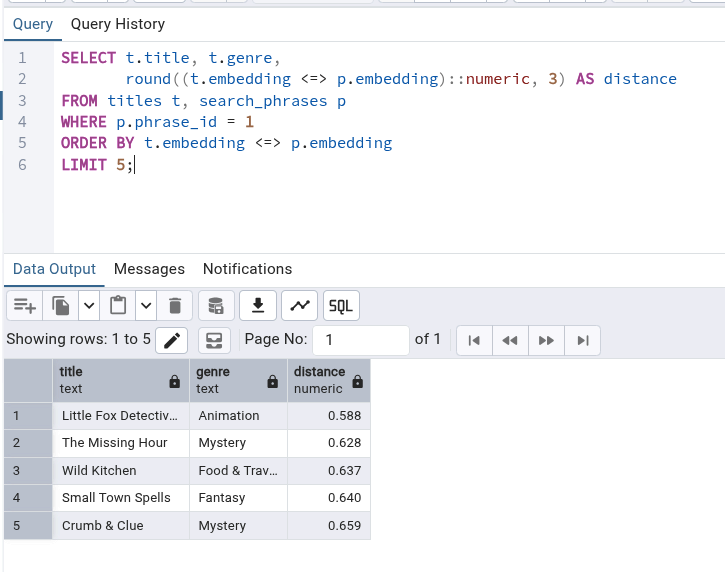
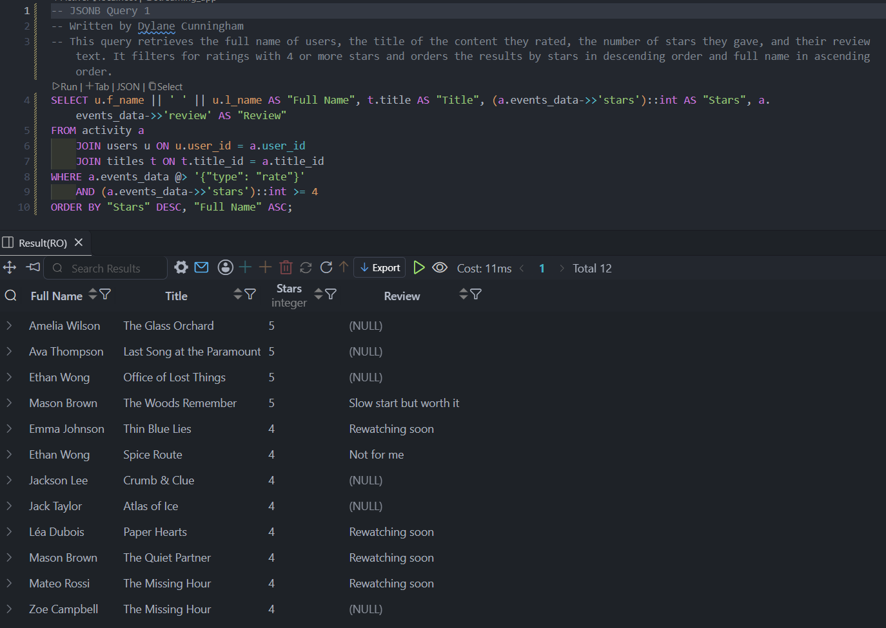
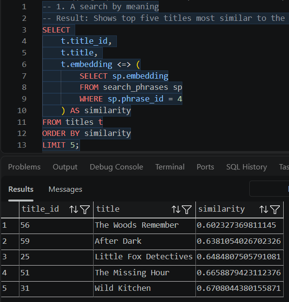

# ADVDB-Activity3-Group3

This activity builds a small PostgresSQL databse for a media streaming service.
Structured data goes into ordinary columns, data whoes shape varies foes in JSONB,
and title descriptions are stores as vectors so viewers can search by meaning. 

## Tools and Enviorment

| Tool | Purpose |
|------|---------|
| PostgreSQL | Database engine |
| pgAdmin 4 | Query building, running SQL, inspecting tables |
| Lucidchart | Schema / ER diagram |
| pgvector | Vector columns and similarity search |

## Enviorment Setup

1. Insure Postgres is installed
2. Insure that pgadmin4 is installed
3. Create empty Database
    1. `sql/01_tables.sql` (creates schema)
    2. `sql/02_vector_data.sql` (generated vector data from provided .ipynb file) 
    3. `sql/03_sample_data.sql` (inserts sample rows)
    4. `sql/04_queries.sql` (run queries one at a time to see results)

## Schema Diagram 

Built in Lucidchart and exported to `schema/schema.pdf`

## Screenshots / Sample Output

Sample Data Results

JSONB Query Results

Vector Query Results

